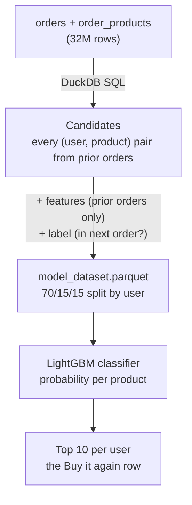

# Buy it again: Grocery Reorder Prediction

A "Buy it again" recommender for a grocery app: for each user, rank the products they have bought before and show the 10 most likely to be in their next order.

Built on the Instacart dataset (3.4M orders, 206k users, 50k products) with **DuckDB SQL** for feature engineering and **LightGBM** for ranking.

## Results (held-out test set, 18,575 users)
|Approach|Recall@5|Recall@10|Precision@10|
|---|---|---|---|
|Popularity baseline|0.235|0.381|0.197|
|Most-frequent baseline|0.373|0.536|0.302|
|LightGBM classifier|0.401|0.575|0.325|
|**LightGBM + due-ness features (final)**|**0.407**|**0.580**|**0.330**|

The final model improves recall@10 over the most-frequent baseline by **+4.38 points (8.2% relative)**, 95% CI [+4.10, +4.67] from a paired per-user comparison.

**Recall@10** = of the products a user actually reordered, the share that appeared in our top 10.

## Approach


**Features**

|Group|Features|
|---|---|
|User-product history|`purchase_count`, `purchase_share`,`orders_since_last_purchase`|
|User|`user_total_prior_orders`, `user_avg_days_between_orders`|
|Product|`product_total_purchases`, `product_reorder_rate`|
|**Due-ness (timing)**|`days_since_last_purchase`, `avg_days_between_purchases`, `due_ratio`|

**Due-ness** asks whether a product is due to be bought again, given this user's own rhythm for it: `due_ratio= days since last purchase/usual days between purchases`. Products with a ratio of 0.5-1.5 are reordered ~26% of the time, versus 9.8% overall.

**Evaluation design**
- **No leakage:** features use only prior orders; the target order is used only for labels.
- **User-level split (70/15/15):** test users are never seen in training.
- **Baseline first:** every model is compared with a simple rule a real app would ship.
- **Test set used once,** after all decisions were made on validation.

## Key findings
1. **`reorder_ratio` is redundant.** For a product bought *n* times it always equals (n-1)/n (verified on all 13.3M pairs), so it was replaced by `purchase_share`.
2. **Due-ness gives a small but real gain:** +0.46 points recall@10 on validation (95% CI +0.32 to +0.61) and +0.51 on test. The day-based features took over part of the role of `orders_since_last_purchase` (gain share 45% -> 29%).
3. **Ranker vs classifier: a tie** LightGBM lambdarank matched the classifier (0.574 vs 0.574). The classifier was kept: simpler and it outputs probabilities.
4. **Tuning didn't help** 8 settings all landed within 0.5777-0.5784. Training on 30% of users nearly matched full data, so performance is limited by features, not model size or data volume.
5. **Feature importance by gain, not split count** `product_total_purchases` is used in the most splits but contributes only ~1.6% of gain.

## Project structure
```
├── notebooks/
│   ├── 01_data_exploration.ipynb    EDA
│   ├── 02_feature_engineering.ipynb candidates, features, labels, split (DuckDB)
│   └── 03_model_training.ipynb      baselines, LightGBM, due-ness, tuning, test
├── src/evaluate.py                   ranking metrics (recall@k, precision@k)
├── tests/test_evaluate.py            unit tests for the metrics
├── models/                           model configs (features, params, scores)
├── reports/                          validation, tuning and test results (CSV)
└── requirements.txt
```

## How to run
1. **Get the data:** download the [Instacart Market Basket Analysis dataset](https://www.kaggle.com/datasets/psparks/instacart-market-basket-analysis) and put the CSVs in `data/raw/`.
2. **Install:** (Python 3.12):
   ```bash
   pip install -r requirements.txt
   ```
3. **Run the notebooks in order:** 01->02->03. Notebook 02 writes `data/processed/model_dataset.parquet`, which 03 reads.
4. **Run the tests:**
   ```bash
   python -m pytest
   ```

## Limitations
- **2017 US data,** used as a stand-in for a grocery or quick-commerce app.
- **No real dates:** gaps between orders are capped at 30 days and history covers at most about a year.
- **Ceiling:** products a user has never bought can't appear in a "Buy it again" row; 6.6% of users reordered nothing they had bought before.

## Next steps
- Error analysis by user type and department, with SHAP explanations.
- Cold-start rule for users with very few orders.
- API endpoint and a small demo of the "Buy it again" row.